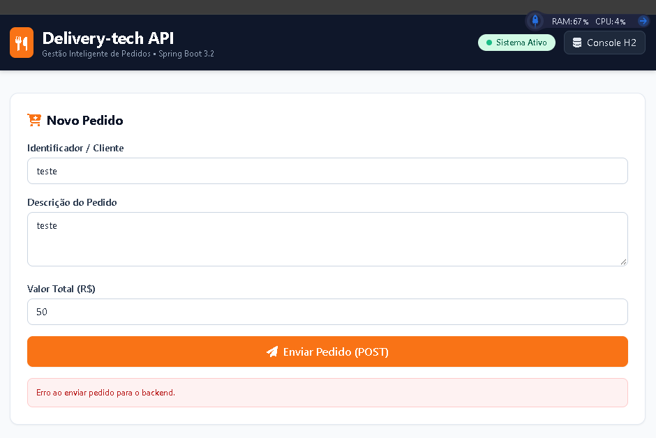

<!-- 
Label: 🚀 [Delivery-tech]: Automação Dinâmica com MakeProject.sh, Templates e Spring Boot
Description: 👻 Guia completo de engenharia de automação de projetos de TI utilizando scripts Bash modulares baseados em templates (.tpl), versionamento seguro com idempotência e ecossistema Spring Boot / H2 / JPA integrado com práticas ágeis Scrum.
technical_requirement: Lógica de Programação, Estrutura de Dados, Networking, Inglês Técnico, Resolução de Problemas, Automação Bash, Spring Boot, Maven.
skills: Aprendizado Contínuo, Design de Sistemas Escaláveis, Metodologias Ágeis (Scrum/Kanban), DevOps e CI/CD, Pensamento Crítico e Análise, Automação de Processos, Arquitetura de Software.
professions: Desenvolvedor(a) Full Stack, Arquiteto(a) de Software, Gerente de Projeto (PM), Engenheiro(a) de DevOps, Scrum Master, Product Owner.
Tags: Fund, Dev, Skils, DevOps
path_hook: hookfigma.hook9, hookfigma.hook7, hookfigma.hook13, hookfigma.hook18
-->

[](https://spring.io/projects/spring-boot)
[](https://maven.apache.org/)
[](https://www.gnu.org/software/bash/)
[](https://adoptium.net/)

# 📘 Guia Definitivo: Automação e Orquestração de Projetos com `MakeProject.sh`



**Projeto:** Automação de Projetos de TI com Scrum e Spring Boot  
**Autor / Coordenação:** Fabiano Rocha  
**Script Principal:** `MakeProject.sh` | **Configuração Padrão:** `projeto.cfg`

---

## 🌐 1. Visão Geral da Arquitetura e Automação

O ecossistema **Delivery-tech** representa um marco na padronização de entregas acadêmicas e corporativas de tecnologia. Por meio do script orquestrador **`MakeProject.sh`**, a criação de novos softwares deixa de ser manual e passa a ser regida por uma **Arquitetura Orientada a Templates (`.tpl`)**, combinada com configurações centralizadas (`projeto.cfg`). O script é desacoplado e totalmente dinâmico, e gera em segundos toda a infraestrutura de um novo projeto.

**Principais características:**

1. **Documentação de Gestão:** TAP (Iniciação), Governança Ágil/Scrum (Encontro 04), Escopo Detalhado, Backlog de 16 Práticas, Matriz de Riscos e Stakeholders.
2. **Arquitetura Técnica de Backend:** Estrutura completa em camadas (Model, DAO/Repository, Service, Controller) em **Java 17+** com **Spring Boot 3.x**, `pom.xml` Maven e `application.properties` configurado para H2/PostgreSQL, usando banco em memória **H2**.
3. **Idempotência Garantida:** Proteção total contra sobrescrita. Qualquer arquivo já existente no disco é preservado (`⏭️ Pulado: ... já existe`), permitindo reexecuções seguras sem perda de progresso.
4. **Compatibilidade Multiplataforma UTF-8:** Os arquivos de documentação (`.md`, `.txt`) são gerados com o cabeçalho UTF-8 BOM (bytes `EF BB BF`), garantindo exibição correta e sem *mojibake* no Windows (Notepad, Word, PowerShell, Office) e no Linux/macOS.

---

## 📈 2. Linha do Tempo Cronológica Detalhada

### 🚀 Início: Concepção e Planejamento (Semanas 1 a 3)
- **Elaboração do TAP:** Definição formal do Termo de Abertura do Projeto, escopo inicial, restrições e premissas.
- **Estruturação do Framework Ágil:** Implantação da governança Scrum no Encontro 04, estabelecendo papéis (Product Owner, Scrum Master, Development Team), cadências de rituais e o **Team Charter**.
- **Criação do Motor de Automação:** Desenvolvimento inicial do `MakeProject.sh` e padronização do arquivo de variáveis `projeto.cfg`.

### ⚡ Meados: Refatoração Arquitetural e Padronização (Semanas 4 a 8)
- **Migração para Templates (`.tpl`):** Desacoplamento completo do código embutido no script bash, movendo toda a estrutura de documentação e código-fonte para a pasta `templates/`.
- **Tratamento de Encoding UTF-8:** Resolução definitiva de erros de *mojibake* e incompatibilidades de caracteres especiais em ambientes Windows (Git Bash / MSYS) através da exportação global das variáveis de ambiente `LANG` e `LC_ALL`.
- **Implementação do Spring Boot:** Criação dinâmica da entidade principal `Pedido` (`tb_pedido`), camada DAO (`JpaRepository`), lógica de negócios e controladores REST.

### 🏁 Fim: Consolidação, Build Automatizado e Deploy Local (Semanas 9 a 16)
- **Criação do Script `up.sh`:** Automação do build via Apache Maven (`mvn clean package`) e inicialização controlada da aplicação na porta configurada.
- **Validação de Endpoints:** Testes de rotas REST, tratamento de páginas de erro e verificação de integridade via Actuator.
- **Geração de Documentação Completa:** Versionamento e organização de todo o repositório, contemplando Backlog de Sprints, Matriz de Riscos e Registro de Stakeholders.

---

## 📊 3. Insights Chaves da Automação

| Pergunta de Validação | Resposta | Insights Acionáveis para Arquitetura e Gestão |
| :--- | :--- | :--- |
| **A automação reduz o tempo de setup inicial de novos projetos?** | **Sim** | Elimina a criação manual de pastas, arquivos de configuração e boilerplate, reduzindo o setup de horas para segundos. |
| **O uso de templates (`.tpl`) desacopla a regra de negócio do script de execução?** | **Sim** | Facilita a manutenção evolutiva: alterações em padrões de código ou documentação exigem apenas a edição do template correspondente. |
| **A idempotência protege o trabalho incremental da equipe?** | **Sim** | Impede que execuções acidentais ou repetidas do script apaguem códigos customizados ou evoluções feitas pela equipe. |
| **A padronização de encoding (`UTF-8 BOM`) resolve problemas em equipes mistas (Windows/Linux)?** | **Sim** | Garante que acentuações e caracteres especiais da língua portuguesa sejam renderizados corretamente em qualquer sistema operacional ou IDE. |

---

## 📚 4. Jargões e Termos Técnicos Relevantes

| Termo / Sigla | Definição Concisa no Contexto do Projeto |
| :--- | :--- |
| **Idempotência** | Propriedade de uma operação poder ser aplicada várias vezes sem mudar o resultado após a aplicação inicial (proteção contra sobrescrita). |
| **Mojibake** | Corrupção de caracteres em que texto codificado em UTF-8 é decodificado incorretamente com uma codificação legada (ex: ISO-8859-1). |
| **Boilerplate** | Seções de código repetitivas e necessárias, incluídas em múltiplos locais com pouca ou nenhuma alteração. |
| **Spring Boot Starter** | Conjunto de descritores de dependência que você inclui na aplicação para acelerar o ecossistema Spring. |
| **H2 Database** | Banco de dados relacional escrito em Java, leve e de alta performance, ideal para testes e desenvolvimento rápido em memória. |
| **DTO / Entity** | Padrões para separar os objetos de persistência mapeados no banco dos objetos de transferência de dados. |

---

## 📋 5. As 3 Categorias de Configuração (`projeto.cfg`)

O arquivo `.cfg` é o cérebro da automação. Para entender e dar manutenção em cada bloco:

### 🔹 5.1 Configurações Gerais do Projeto (Identificação e Prazos)
* **Finalidade:** Controla a identificação formal, o diretório físico no disco e os prazos acadêmicos.
* **Onde impacta:** Cabeçalhos do TAP, marcos de Sprints e README principal.

| Variável | Exemplo | Finalidade |
| :--- | :--- | :--- |
| `PROJECT_NAME` | `"Delivery-tech"` | Nome oficial do produto ou startup (usado em títulos e no pom.xml). |
| `PROJECT_DIR` | `"delivery-tech-complete"` | Nome da pasta raiz criada fisicamente no disco. |
| `COURSE_NAME` | `"Gestão de Projetos de TI..."` | Nome completo da disciplina, instituição e turma. |
| `PROJECT_CODE` | `"QSP-GPTI-T9-Delivery"` | Código identificador formal do projeto nos relatórios acadêmicos. |
| `PROJECT_MANAGER` | `"Fabiano Rocha"` | Nome do Gerente do Projeto ou líder responsável pela entrega. |
| `START_DATE` | `"05/11/2026"` | Data de início formal das atividades (formato `DD/MM/AAAA`). |
| `END_DATE` | `"17/12/2026"` | Data de término / encerramento formal do cronograma. |

---

### 🔹 5.2 Configurações de Negócio / Domínio (Gestão Ágil, TAP e Escopo)
* **Finalidade:** Fornece a identidade comercial e os limites funcionais do sistema.
* **Onde impacta:** Justificativa do TAP, Declaração de Escopo, Visão do Produto (*Product Vision*) no Scrum e Mapeamento de Stakeholders.

| Variável | Exemplo | Finalidade |
| :--- | :--- | :--- |
| `BUSINESS_SEGMENT` | `"Delivery de Alimentos e Refeições"` | Área de atuação ou mercado do produto. |
| `TARGET_AUDIENCE` | `"Consumidores, restaurantes locais..."` | Quem são os usuários finais atendidos. |
| `VALUE_PROPOSITION` | `"conectar clientes e restaurantes..."` | Declaração de valor único e transformação gerada pelo produto. |
| `OUT_OF_SCOPE_DEF` | `"Frota física própria de entregadores..."` | O que deliberadamente **não** será feito nesta primeira fase. |

> **Dica de Ouro:** Para reutilizar o script em outro ramo (ex: clínica médica, oficina mecânica, e-commerce), basta alterar esses 4 campos; toda a documentação de gestão será gerada e contextualizada automaticamente.

---

### 🔹 5.3 Configurações Técnicas (Java Spring Boot e Persistência)
* **Finalidade:** Governa a compilação Maven, os pacotes Java e as entidades JPA.
* **Onde impacta:** `pom.xml`, árvore de diretórios Java, nomes de classes e tabelas do banco.

| Variável | Exemplo | Finalidade |
| :--- | :--- | :--- |
| `PACKAGE_BASE` | `"com.deliverytech"` | Pacote raiz Java (o script converte `.` em `/` e cria as pastas dinamicamente). |
| `GROUP_ID` | `"com.deliverytech"` | Identificador de grupo no `pom.xml`. |
| `ARTIFACT_ID` | `"deliverytech-api"` | Nome do artefato / jar do projeto no `pom.xml`. |
| `MAIN_ENTITY` | `"Pedido"` | Nome da classe da entidade principal em PascalCase. Gera `${MAIN_ENTITY}.java`, `Repository`, `Service` e `Controller`. |
| `MAIN_ENTITY_TABLE` | `"tb_pedido"` | Nome físico da tabela mapeada na anotação `@Table(name="...")`. |
| `SERVER_PORT` | `"8080"` | Porta TCP onde a aplicação Spring Boot subirá (`application.properties`). |

---

## 🛠️ 6. Tutoriais de Manutenção e Expansão

### 📌 Caso 1: Como Adicionar um Novo Documento de Gestão (Ex: Encontro 05 ou Ata)
1. **Crie o template:** Adicione o arquivo `.tpl` na pasta correspondente em `templates/`.
   * Exemplo: `templates/02-Planejamento/Governanca/Encontro_05_Modelagem_Dados.md.tpl`
2. **Escreva o conteúdo:** Utilize variáveis dinâmicas onde necessário (`$PROJECT_NAME`, `$PROJECT_MANAGER`, `$COURSE_NAME`, etc.).
3. **Adicione a chamada no `MakeProject.sh`:**
   ```bash
   render_template "$TEMPLATES_DIR/02-Planejamento/Governanca/Encontro_05_Modelagem_Dados.md.tpl" \
                   "$PROJECT_DIR/02-Planejamento/Governanca/Encontro_05_Modelagem_Dados.md"
   ```

---

### 📌 Caso 2: Como Adicionar Novas Entidades Java (Ex: Restaurante, Produto, Cliente)
Para gerar outras entidades além da principal definida em `$MAIN_ENTITY`, reutilize os templates de backend existentes:
```bash
MAIN_ENTITY="Restaurante" MAIN_ENTITY_TABLE="tb_restaurante" ENDPOINT_NAME="restaurantes" \
render_template "$TEMPLATES_DIR/03-Execucao/src/main/java/model/Model.java.tpl" \
                "$PROJECT_DIR/03-Execucao/src/main/java/$PACKAGE_PATH/model/Restaurante.java"

MAIN_ENTITY="Restaurante" \
render_template "$TEMPLATES_DIR/03-Execucao/src/main/java/dao/Repository.java.tpl" \
                "$PROJECT_DIR/03-Execucao/src/main/java/$PACKAGE_PATH/dao/RestauranteRepository.java"
```

---

### 📌 Caso 3: Como Adicionar Novas Variáveis no `.cfg` e Propagá-las
1. **Adicione no seu `projeto.cfg`:**
   ```ini
   DATABASE_NAME="meubanco"
   ```
2. **Adicione o export no `MakeProject.sh` com fallback inteligente:**
   ```bash
   export DATABASE_NAME="${DATABASE_NAME:-deliverytechdb}"
   ```
3. **Adicione a substituição no fallback `sed` (dentro de `render_template`):**
   ```bash
   -e "s|\$DATABASE_NAME|$DATABASE_NAME|g"
   ```
4. **Use livremente:** A variável `$DATABASE_NAME` agora pode ser usada em qualquer template `.tpl`.

---

### 📌 Caso 4: Como Forçar a Recriação de um Arquivo Específico
* O script respeita o **Princípio de Não-Sobrescrita**: arquivos existentes nunca são apagados ou alterados.
* Se você alterar o `.cfg` ou um template e quiser regenerar um arquivo específico, apague-o ou renomeie-o no destino e execute o script novamente:
  ```bash
  rm delivery-tech-complete/01-Iniciacao/Termo_Abertura_Projeto.md
  ./MakeProject.sh
  ```

---

## 📂 7. Mapa da Estrutura de Templates

A pasta `templates/` espelha o diretório final do projeto:

```text
📁 templates/
├── 📁 01-Iniciacao/
│   └── 📄 Termo_Abertura_Projeto.md.tpl
├── 📁 02-Planejamento/
│   ├── 📁 Arquitetura-Tecnica/
│   │   └── 📄 Especificacao_Arquitetura.md.tpl
│   ├── 📁 Backlog-Sprints/
│   │   └── 📄 Product_Backlog.md.tpl
│   ├── 📁 Escopo/
│   │   └── 📄 Escopo_Projeto.md.tpl
│   ├── 📁 Governanca/
│   │   └── 📄 Encontro_04_Governanca_Scrum.md.tpl
│   ├── 📁 Riscos/
│   │   └── 📄 Registro_Riscos.md.tpl
│   └── 📁 Stakeholders/
│       └── 📄 Registro_Stakeholders.md.tpl
├── 📁 03-Execucao/
│   ├── 📦 pom.xml.tpl
│   └── 📁 src/main/
│       ├── 📁 java/
│       │   ├── 📁 controller/
│       │   │   └── ☕ Controller.java.tpl
│       │   ├── 📁 dao/
│       │   │   └── ☕ Repository.java.tpl
│       │   ├── 📁 model/
│       │   │   └── ☕ Model.java.tpl
│       │   └── 📁 service/
│       │       └── ☕ Service.java.tpl
│       └── 📁 resources/
│           └── ⚙️ application.properties.tpl
└── 📄 README.md.tpl
```

---

## ⚡ 8. Como Executar

```bash
# Execução padrão (utiliza projeto.cfg)
./MakeProject.sh

# Execução com arquivo de configuração personalizado
./MakeProject.sh outro_projeto.cfg
```

---

## 💡 Frase de Engajamento

> "Automatizar processos repetitivos não é apenas uma questão de eficiência técnica, mas uma estratégia fundamental para liberar o potencial criativo da equipe de desenvolvimento, permitindo foco absoluto na entrega de valor real ao negócio e na excelência da arquitetura de software. Agradeço imensamente o privilégio desta jornada de aprendizado e compartilhamento tecnológico ao lado da comunidade e dos parceiros do programa Qualifica São Paulo / Fundação FAT (Turma T9) sob a coordenação da Prof. Carla Panegocci."

---

Data de emissão: 13/11/2026